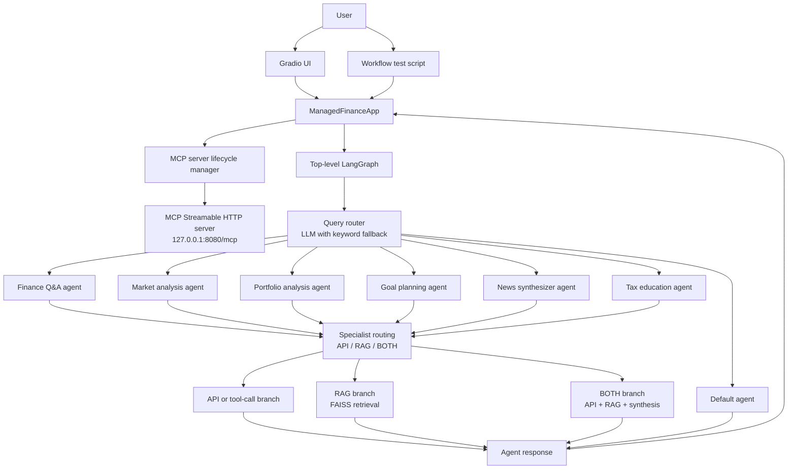

# AI Finance Assistant Architecture

## Overview

The application accepts a finance question through the Gradio UI or a Python
workflow caller. A LangGraph workflow routes the question to one of six
specialist agents. Most specialists have their own router that selects
retrieval (RAG), an external/local API tool, or a combined response. The
selected agent returns a response in workflow state.

## Component architecture

### Entry points

- [Gradio UI](./src/web_app/ui_aiFinanceWorkflow.py) accepts a question and
  displays the selected agent and response.
- [Workflow test script](./src/workflow/run_workflow/test_aiFinanceWorkflow.py)
  invokes the workflow with example questions.
- [MCP server](./src/mcp/server/aiFinanceAssistant_server.py) can run separately
  over stdio or Streamable HTTP.
- [MCP client](./src/mcp/client/aiFinanceAssistant_client.py) provides async
  methods to list and call the server's tools.

### Main workflow

[The workflow](./src/workflow/aiFinanceWorkflow.py) uses a state with these
fields:

| Field | Purpose |
|---|---|
| `user_input` | User's original question |
| `selected_agent` | Route selected by the top-level router |
| `response` | Final response produced by the selected agent |

The top-level router in [router_agent.py](./src/agents/router_agent.py) uses
the chat model configured by `OPENAI_MODEL` and keyword heuristics when routing
fails or the LLM is unavailable. It selects one of the specialist agents or the
default agent.

### Specialist routing and data sources

Specialist agents are implemented under [src/agents](./src/agents). Finance
Q&A, market analysis, portfolio analysis, goal planning, news synthesis, and
tax education each use an inner router to choose an API/tool branch, a RAG
branch, or a synthesis branch. The synthesis branch obtains both API/tool and
RAG results and asks an LLM to organize the provided data without adding
unsupported facts.

| Specialist | API/tool path | RAG path |
|---|---|---|
| Finance Q&A | [MCP client-call module](./src/api/finance_qa_api_mcp_client_call_agent.py) | [Finance Q&A RAG](./src/rag/finance_qa_rag_agent.py) |
| Market analysis | [MCP client-call module](./src/api/market_analysis_api_mcp_client_call_agent.py) | [Market RAG](./src/rag/market_analysis_rag_agent.py) |
| Portfolio analysis | [MCP client-call module](./src/api/portfolio_analysis_api_mcp_client_call_agent.py) | [Portfolio RAG](./src/rag/portfolio_analysis_rag_agent.py) |
| Goal planning | [Goal API/tool module](./src/api/goal_planning_api_tool_call_agent.py) | [Goal-planning RAG](./src/rag/goal_planning_rag_agent.py) |
| News synthesis | [News API/tool module](./src/api/news_synthesizer_api_tool_call_agent.py) | [News RAG](./src/rag/news_synthesizer_rag_agent.py) |
| Tax education | [Tax API/tool module](./src/api/tax_education_api_tool_call_agent.py) | [Tax RAG](./src/rag/tax_education_rag_agent.py) |

RAG modules retrieve relevant entries from FAISS indexes under
[src/rag/indexes](./src/rag/indexes). The retrieval code can build an index
from its corresponding documents when the index is missing. Embeddings use the
model configured by `OPENAI_EMBEDDINGS_MODEL`.

The tool implementations live under [src/tools](./src/tools). They provide
Alpha Vantage quote, news, and portfolio data; goal contribution calculations;
tax-topic explanations; and Wikipedia summaries.

## Data flow

1. The UI or another caller passes a state containing `user_input` to
   `financeApp.invoke(...)` (or `ainvoke(...)`).
2. `ManagedFinanceApp` calls `begin_workflow()` before invoking the compiled
   graph. The lifecycle manager checks for the MCP Streamable HTTP service and
   starts it on `127.0.0.1:8080` if it is not ready.
3. The top-level router classifies the question and sets `selected_agent`.
4. The selected specialist agent receives the question and routes it to API,
   RAG, or BOTH:
   - API/tool branches call an external data source or local calculation.
   - RAG branches retrieve relevant indexed content.
   - BOTH branches collect both outputs and synthesize them.
5. The selected path writes a `response`; the workflow returns the final state
   to the caller.
6. `ManagedFinanceApp` calls `end_workflow()` in a `finally` block. The
   lifecycle manager stops the HTTP server it started after the last active
   workflow completes. A separately/manual-started server is not owned or
   stopped by the workflow.

## MCP topology

The MCP server exposes seven tools:

- `finance_qa_tool`
- `goal_planning_tool`
- `market_alpha_vantage_tool`
- `alpha_vantage_news_tool`
- `portfolio_alpha_vantage_tool`
- `tax_education_tool`
- `mediawiki_summary_tool`

The server supports both stdio and Streamable HTTP. The lifecycle manager uses
Streamable HTTP at `http://127.0.0.1:8080/mcp` to check availability and manage
the listener. The current [MCP client](./src/mcp/client/aiFinanceAssistant_client.py)
uses stdio and starts the server as a child process when a client context is
opened. Therefore, the HTTP listener managed around workflow execution and
stdio MCP tool calls are currently separate server transports/process
connections.

## External configuration

Create a private `.env` file at the project root for required credentials and
configuration. Depending on the route used, the application may need:

- `OPENAI_API_KEY` for LLM routing, synthesis, and embeddings.
- `OPENAI_MODEL` for chat model selection (defaults to `gpt-4o-mini`).
- `OPENAI_EMBEDDINGS_MODEL` for FAISS embedding operations.
- `ALPHAVANTAGE_API_KEY` (or `ALPHA_VANTAGE_API_KEY`) for Alpha Vantage tools.

Install Python dependencies from [requirements.txt](./requirements.txt). For
Windows execution commands, see [Instruction.md](./Instruction.md).
